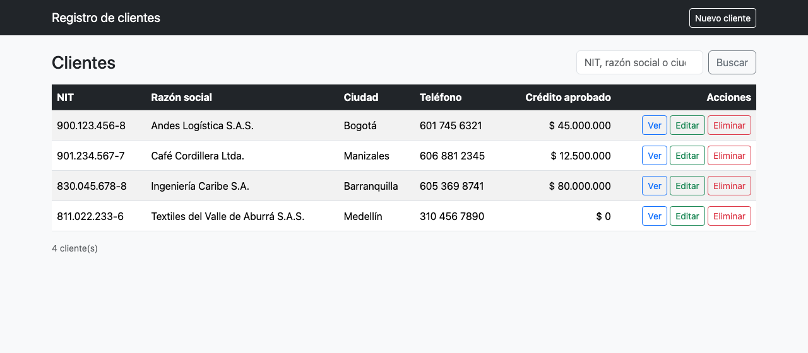
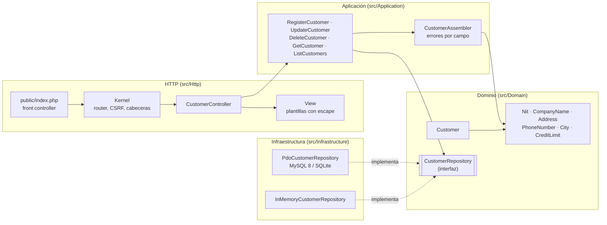

# Registro de clientes en PHP con Clean Architecture: CRUD con PDO, MySQL y validación de NIT DIAN

[](https://github.com/KevinAndrey96/php-clean-architecture-customer-crud/actions/workflows/ci.yml)


[](LICENSE)

CRUD de clientes empresariales escrito en **PHP 8.2+ sin framework**, organizado en capas de **Clean Architecture** (dominio, aplicación, infraestructura y HTTP), con **PDO y sentencias preparadas**, validación del **NIT colombiano con su dígito de verificación DIAN (módulo 11)**, protección **CSRF**, escape de salida contra **XSS**, patrón **Post/Redirect/Get** y un stack **Docker Compose** con MySQL 8.4 listo para correr.

El proyecto nació en 2017 como un CRUD procedural (`Modelo/`, `Vista/`, `Controlador/`) y en 2026 se reescribió como **referencia didáctica de migración de PHP legacy a arquitectura limpia**. El código original se conserva en el tag [`v1.0-legacy-2017`](https://github.com/KevinAndrey96/php-clean-architecture-customer-crud/tree/v1.0-legacy-2017) para comparar ambas versiones.



## Características

- **Alta, consulta, edición y eliminación** de clientes con búsqueda por NIT, razón social o ciudad.
- **NIT con dígito de verificación DIAN**: acepta `860007386`, `860007386-1` o `860.007.386-1`; si el usuario escribe el DV, se valida.
- **Cambio de NIT en la edición**: el registro se direcciona por su NIT actual, así que el propio NIT se puede corregir.
- **Validación por campo**: el formulario marca todos los errores a la vez y conserva lo que el usuario escribió.
- **Teléfonos del plan de numeración 2021** (10 dígitos: celular `3XX` o fijo `60X`), con o sin `+57`.
- **Crédito en pesos colombianos** con notación local (`$ 15.000.000`).
- **Eliminación confirmada** mediante `POST` con token CSRF, nunca con un enlace `GET`.
- **SQL portable** entre MySQL 8 y SQLite: la misma clase de repositorio corre en los tests y en producción.

## Arquitectura



Las dependencias apuntan hacia el dominio: el dominio no conoce PDO, HTTP ni sesiones. `AppFactory` es la raíz de composición y el único lugar que instancia clases concretas.

| Capa | Responsabilidad | Clases |
| :--- | :--- | :--- |
| Dominio | Reglas de negocio e invariantes | `Customer`, `Nit`, `PhoneNumber`, `CreditLimit`, `BoundedText`, `CustomerRepository` |
| Aplicación | Casos de uso y traducción de errores a campos del formulario | `RegisterCustomer`, `UpdateCustomer`, `DeleteCustomer`, `GetCustomer`, `ListCustomers`, `CustomerAssembler` |
| Infraestructura | Persistencia con PDO y configuración por entorno | `PdoCustomerRepository`, `InMemoryCustomerRepository`, `ConnectionFactory` |
| HTTP | Rutas, CSRF, sesión, vistas y cabeceras de seguridad | `Kernel`, `CustomerController`, `View`, `Csrf`, `Flash` |

## Dígito de verificación del NIT (algoritmo DIAN)

Cada dígito del NIT, de derecha a izquierda, se multiplica por un peso primo \(w = 3, 7, 13, 17, 19, 23, 29, 37, 41, 43, 47, 53, 59, 67, 71\):

$$
r = \left( \sum_{i=1}^{n} d_i \cdot w_i \right) \bmod 11
\qquad
DV = \begin{cases} r & \text{si } r \in \{0, 1\} \\ 11 - r & \text{en otro caso} \end{cases}
$$

Ejemplo con el NIT público de la DIAN, `800197268`:

| Dígito (der. a izq.) | 8 | 6 | 2 | 7 | 9 | 1 | 0 | 0 | 8 |
| :--- | ---: | ---: | ---: | ---: | ---: | ---: | ---: | ---: | ---: |
| Peso | 3 | 7 | 13 | 17 | 19 | 23 | 29 | 37 | 41 |
| Producto | 24 | 42 | 26 | 119 | 171 | 23 | 0 | 0 | 328 |

La suma es 733, \(733 \bmod 11 = 7\) y el DV es \(11 - 7 = 4\): **800.197.268-4**. Los tests verifican además los NIT de Bancolombia (890.903.938-8) y Ecopetrol (899.999.068-1). El mismo algoritmo está publicado como paquete Python en [python-dian-nit-validator](https://github.com/KevinAndrey96/python-dian-nit-validator).

## Rutas

| Método | Ruta | Acción |
| :--- | :--- | :--- |
| `GET` | `/?q=texto` | Listado y búsqueda |
| `GET` | `/customers/new` | Formulario de alta |
| `POST` | `/customers` | Registrar (303 al detalle o 422 con errores) |
| `GET` | `/customers/{nit}` | Detalle |
| `GET` | `/customers/{nit}/edit` | Formulario de edición |
| `POST` | `/customers/{nit}` | Actualizar, incluso el NIT |
| `GET` | `/customers/{nit}/delete` | Confirmación |
| `POST` | `/customers/{nit}/delete` | Eliminar |

## Seguridad

| Riesgo | Control |
| :--- | :--- |
| Inyección SQL | Solo sentencias preparadas con `ATTR_EMULATE_PREPARES` desactivado; los comodines `%` y `_` de la búsqueda se escapan |
| XSS | Toda salida pasa por `htmlspecialchars` con `ENT_QUOTES`; CSP `default-src 'none'` |
| CSRF | Token por sesión de 256 bits comparado con `hash_equals` en todo `POST` |
| Clickjacking | `frame-ancestors 'none'` y `X-Frame-Options: DENY` |
| Sesión | Cookie `HttpOnly`, `SameSite=Lax`, `Secure` bajo HTTPS y `use_strict_mode` |
| Credenciales | `DB_DSN`, `DB_USER` y `DB_PASSWORD` por entorno; nada en el código ni en el historial |
| Superficie del servidor | Apache como `www-data` en el puerto 8080, `ServerTokens Prod`, `expose_php = Off`, sin listado de directorios |

## Inicio rápido con Docker

```bash
git clone https://github.com/KevinAndrey96/php-clean-architecture-customer-crud.git
cd php-clean-architecture-customer-crud
cp .env.example .env          # cambie las contraseñas
docker compose up -d --build --wait
open http://localhost:8080
```

MySQL carga `database/schema.sql` y cuatro empresas ficticias de `database/seed.sql` en el primer arranque. Para ejecutar la prueba de humo de punta a punta contra el stack: `./scripts/smoke-test.sh 8080`.

## Desarrollo y pruebas

```bash
composer install
composer analyse   # PHPStan en nivel max sobre src, public y tests
composer test      # PHPUnit: unit, integration (SQLite en memoria) y http
```

| Suite | Qué cubre |
| :--- | :--- |
| `unit` | Algoritmo DV con NIT públicos, formatos aceptados y rechazados, teléfonos, crédito y los cinco casos de uso |
| `integration` | Un contrato común de `CustomerRepository` ejecutado en memoria, en SQLite y, si existe `TEST_MYSQL_DSN`, en MySQL 8.4 |
| `http` | Kernel completo: 303 y 422, CSRF, escape de HTML, flash de un solo uso, cambio de NIT, 404, 405 y cabeceras |

El CI ejecuta PHPStan y PHPUnit en PHP 8.2, 8.3 y 8.4, el contrato del repositorio contra un servicio MySQL 8.4 real y la prueba de humo sobre el stack de Docker Compose.

## Modernización 2026: antes y después

| Defecto en la versión de 2017 | Corrección |
| :--- | :--- |
| Todas las redirecciones iban a `Vista/index.php`, que no existía | Front controller único con rutas explícitas y 404 para lo demás |
| Bootstrap 2 se buscaba en `Modelo/css/`, por lo que la interfaz salía sin estilos | Bootstrap 5.3 desde CDN con integridad SRI |
| Los datos se imprimían sin escapar (XSS almacenado) | Escape obligatorio en las plantillas y CSP restrictiva |
| El `UPDATE` filtraba por el NIT nuevo: cambiar el NIT no actualizaba nada | El registro se direcciona por el NIT actual y el nuevo se valida contra duplicados |
| `header('Location')` sin `exit`: el script seguía ejecutándose | Objetos `Response` con 303 See Other |
| Eliminación sin token CSRF | Token por sesión en todo `POST` |
| Usuario `root` con contraseña en el código | Credenciales por entorno y historial de Git purgado |
| Sin esquema SQL: la base no se podía crear | `database/schema.sql` portable y datos semilla con DV válidos |
| Capas invertidas: la conexión en `Controlador/` y las páginas en `Modelo/` | Dominio, aplicación, infraestructura y HTTP separados |
| Solo se validaba que los campos no estuvieran vacíos, y `"0"` contaba como vacío | Value objects con reglas de NIT, teléfono, longitud y crédito, incluido el cero |
| Sin pruebas | Suites unit, integration y http, PHPStan en nivel max y CI con tres jobs |

## Estructura

```
├── database/            schema.sql portable y seed.sql
├── docker/              vhost de Apache
├── public/index.php     front controller
├── scripts/             prueba de humo de punta a punta
├── src/
│   ├── Domain/          Customer, value objects, interfaz del repositorio
│   ├── Application/     casos de uso y ensamblador
│   ├── Infrastructure/  repositorios PDO y en memoria, conexión
│   └── Http/            kernel, controlador, vista, CSRF, sesión
├── templates/           plantillas PHP con escape
└── tests/               Unit, Integration y Http
```

## Autor

**Kevin Andrey Herrera Silva**, Senior Backend Engineer. [GitHub @KevinAndrey96](https://github.com/KevinAndrey96)

Licencia [MIT](LICENSE).
